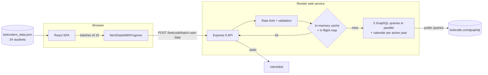

# LeetCode Among Us

[](https://github.com/MCA-NITW/leetcode_among_us/actions/workflows/ci.yml)
[](CHANGELOG.md)
[](package.json)
[](pnpm-workspace.yaml)
[](LICENSE)

A competitive LeetCode tracker for MCA students at NIT Warangal. It pulls public
profile, problem, contest, badge and calendar data from LeetCode's GraphQL API
and renders a sortable leaderboard, per-user analytics, and a head-to-head
comparison view.

Live: <https://leetcode-among-us.onrender.com> (Render free tier: the first
request after ~15 minutes of inactivity takes 30-60 seconds while the service
wakes up).

## Features

- Leaderboard with four tabs, each answering one question: Overview (who is
  winning), Problems, Contests and Consistency. Sortable columns, name search,
  batch filter, medals for the top three, and a Recent Contest Activity feed.
  Below 640px each person becomes a card instead of a 12-column table.
- Derived metrics computed client-side from data the API already returns:
  completion percent, current and best streak (walked across the merged
  multi-year calendar, so a run crossing New Year is not split), rating trend,
  days since last contest, top topic, top language, last solved and
  daily-challenge badge progress.
- User Stats page: profile, difficulty breakdown, topic radar, submission
  heatmap, contest rating history and scatter, badges, streaks.
- Compare page: two users side by side across problems, contests, beats
  percentages and rating history, with an overall winner.
- Dark/light theme (persisted, applied before first paint).
- Server-side cache so the roster loads in seconds on repeat visits and LeetCode
  is not hammered on every page load.

## Stack

| Layer     | Technology                                                            |
| --------- | --------------------------------------------------------------------- |
| Client    | React 19, TypeScript, Vite 8, React Router 7, Chart.js 4, React Icons |
| Server    | Node 22+, Express 5, TypeScript, Helmet, CORS, express-rate-limit     |
| Data      | LeetCode GraphQL API (public queries only), roster JSON in the repo   |
| Tooling   | pnpm 12 workspace, Prettier, Vitest, Supertest                        |
| CI/Deploy | GitHub Actions (org reusable workflows), Render                       |

## Architecture



One request path does all the work:

1. The client reads the roster from the bundled JSON and sends it to the API in
   batches of 10 usernames, updating a progress bar as each batch lands.
2. The API validates every username, then asks `getUserData()` for each one. A
   cache hit returns at once; a miss joins any in-flight fetch for the same
   (case-insensitive) user, so duplicates and concurrent visitors share one
   upstream round-trip.
3. A real miss fires five LeetCode GraphQL queries in parallel (profile,
   contests, problems, skills, badges), then one calendar overview call to learn
   `activeYears`, then one calendar call per active year, 100 ms apart.
4. The client shapes the response (`processUserDataResponse`) and enriches it
   with derived metrics (`enrichUser`) before the leaderboard renders.

### Design decisions

- **Server proxy, not browser calls.** The browser never talks to leetcode.com.
  The server owns the query shape, timeouts (15 s per query), rate limiting and
  caching, and only public, unauthenticated queries are ever sent.
- **Cache plus in-flight de-duplication.** Before 3.1.0 every page load cost
  roughly 10 upstream calls per user, about 350 per visitor. Profiles are now
  held for `CACHE_TTL_MINUTES`; users LeetCode does not know are never cached so
  a fixed typo shows up on the next load.
- **Partial failure is tolerated.** Each query catches its own error, so one
  timed-out query blanks one section instead of dropping the whole row.
- **Calendar years come from LeetCode.** Fetching exactly the user's
  `activeYears` replaced a hardcoded 2022-to-now loop that lost older history
  and wasted calls for later joiners.
- **Roster as data, validated in CI.** Students join by pull request; the same
  validator runs locally, before every client build and in CI.
- **`/health` never calls upstream,** so a LeetCode outage cannot make Render
  restart a healthy instance.

Measured 2026-10-18 against the live service, from India, right after a Render
cold start: one batch of the first 10 roster users took 7.5 s with an empty
cache and 1.5 to 1.8 s on repeat requests served from cache (253 KB of JSON).
Tests: 18 API cases (Vitest + Supertest), 8 roster validator cases and 9 client
data-shaping cases.

## Quick start

Prerequisites: Node 22 or newer and pnpm 12 (`corepack enable` will pick up the
pinned version from `package.json`).

```bash
git clone https://github.com/MCA-NITW/leetcode_among_us.git
cd leetcode_among_us
pnpm install
pnpm dev
```

`pnpm dev` starts the API on <http://localhost:3001> and the Vite client on
<http://localhost:3000>. The client proxies `/leetcode/*` and `/health` to the
API during development (see `client/vite.config.ts`).

### Scripts

| Command              | What it does                                                  |
| -------------------- | ------------------------------------------------------------- |
| `pnpm dev`           | API (tsx watch) + client (Vite) concurrently                  |
| `pnpm start:dev`     | API only, with reload                                         |
| `pnpm build`         | Install, compile server to `dist/`, validate roster, build UI |
| `pnpm start`         | Run the compiled server (serves `client/dist`)                |
| `pnpm test`          | Server tests (Vitest + Supertest) then client tests           |
| `pnpm validate:data` | Validate `client/src/assets/leetcoders_data.json`             |
| `pnpm format`        | Prettier write                                                |
| `pnpm format:check`  | Prettier check (what CI runs)                                 |

## Configuration

Server (`.env`, see `.env.example`):

| Variable            | Default       | Purpose                                          |
| ------------------- | ------------- | ------------------------------------------------ |
| `PORT`              | `3001`        | Listen port                                      |
| `NODE_ENV`          | `development` | Set to `production` on Render                    |
| `CACHE_TTL_MINUTES` | `10`          | How long a fetched profile is served from memory |

Client (`client/.env`, see `client/.env.example`):

| Variable       | Default | Purpose                                                      |
| -------------- | ------- | ------------------------------------------------------------ |
| `VITE_API_URL` | `''`    | API origin when the client is hosted separately from the API |

Leave `VITE_API_URL` empty when Express serves the built client (the default
Render setup).

## API

Both endpoints are rate limited (2000 requests per 5 minutes per IP) and
CORS-restricted to the origins listed in `server.ts`.

| Method | Path                        | Body                          | Notes                                      |
| ------ | --------------------------- | ----------------------------- | ------------------------------------------ |
| `GET`  | `/health`                   | -                             | Liveness probe; never calls LeetCode       |
| `POST` | `/leetcode/user-data`       | `{ "username": "..." }`       | Aggregated profile for one user            |
| `POST` | `/leetcode/batch-user-data` | `{ "usernames": ["...", …] }` | Up to 10 users; duplicates share one fetch |

Usernames must match `^[a-zA-Z0-9_-]{1,40}$`. Invalid input returns 400, unknown
`/leetcode/*` paths a JSON 404, disallowed origins 403. A failing LeetCode query
does not fail the request: that section comes back `null` and the response is
still 200 (even when LeetCode is down entirely), so clients should treat a
missing `userPublicProfile.data.matchedUser` as "no data". 502 (single user) and
500 (batch) are reserved for unexpected handler errors. Successful profiles are
cached for `CACHE_TTL_MINUTES`; not-found users are never cached.

Each profile response bundles five LeetCode queries run in parallel (public
profile, contest ranking and history, problems solved, skill tags, badges) plus
the submission calendar: one overview call for `activeYears`, then one call per
active year.

## Adding yourself to the leaderboard

1. Fork and clone the repository.
2. Add an entry to `client/src/assets/leetcoders_data.json` (template in
   `client/src/assets/TEMPLATE_ENTRY.json`):

   ```json
   {
     "id": "22MCF1R01",
     "name": "Your Name",
     "userName": "your_leetcode_username",
     "batch": "2025",
     "gender": "male"
   }
   ```

3. Run `pnpm validate:data`. It checks required fields, the username pattern,
   four-digit batch, gender value, and duplicate ids/usernames
   (case-insensitive - LeetCode usernames are case-insensitive too).
4. Open a pull request. CI runs the same validation as part of the build.

Your LeetCode profile must be public. See [CONTRIBUTING.md](CONTRIBUTING.md) for
the full guide.

## Project structure

```
.
├── server.ts                    Express 5 API + static server (single file)
├── tsconfig.server.json         Compiles server.ts -> dist/server.js
├── vitest.config.ts             Server test runner config
├── tests/                       Server + validator tests
├── scripts/validate-data.mjs    Roster validator (CLI + importable)
├── client/
│   ├── index.html               CSP meta, fonts, theme pre-paint script
│   ├── vite.config.ts           Dev proxy to :3001
│   ├── vitest.config.ts         Client test runner config
│   ├── tests/                   Client unit tests
│   └── src/
│       ├── api/OptimizedFetchData.ts     Calls the API, shapes responses
│       ├── utils/optimizedLeaderboardData.ts  Batching + progress
│       ├── utils/derivedStats.ts         Streaks, trends, top topic/language
│       ├── assets/leetcoders_data.json   Roster (edit this to add users)
│       ├── components/Charts/            Chart.js wrappers
│       ├── components/{Nav,Loader,ThemeToggle}/
│       ├── contexts/ThemeContext.tsx
│       ├── hooks/useReveal.ts             Scroll-triggered entrance reveals
│       ├── pages/{Home,LeaderBoard,UserStats,Compare}/
│       └── types/index.ts
├── .github/workflows/ci.yml     Calls mca-nitw/.github reusable workflows
└── pnpm-workspace.yaml          Workspace + security overrides
```

## Development notes

- Formatting is enforced by Prettier in CI (`pnpm format:check`). Single quotes,
  no semicolons, 2 spaces, 80 columns, LF line endings. `.gitattributes` pins LF
  on checkout so Windows clones with `core.autocrlf=true` pass the format check
  and the validator test locally.
- Design tokens live in `client/src/index.css` (colours, spacing, radius,
  shadows, motion). Use them; do not add literal colours or durations. For
  motion, reuse the shared utilities: `.reveal` + `useReveal()` for scroll
  entrances, `.stagger` with an inline `--i` for cascading siblings,
  `.card-lift` for hover, and the `g-*` keyframes. Reduced motion is handled
  globally.
- TypeScript runs with `strict`, `noUnusedLocals`, `noUnusedParameters` and
  `noFallthroughCasesInSwitch` on both sides.
- There is no ESLint/Biome yet; adding Biome 2 (lint-only, Prettier stays) is
  the intended next step.
- `pnpm build` runs `pnpm install` first because Render's build command is
  `pnpm build`. Do not remove that without updating the Render service.
- Dependencies are managed by Renovate through the org preset
  (`github>mca-nitw/.github`): one grouped PR per month, security fixes at any
  time, auto-merged when CI is green.

## Deployment

Render web service, root directory `.`, build command `pnpm build`, start
command `pnpm start`, health check path `/health`, environment
`NODE_ENV=production`. The server serves `client/dist` and falls back to
`index.html` for client-side routes.

## Security

See [SECURITY.md](SECURITY.md). The server only issues public, unauthenticated
GraphQL queries; no LeetCode credentials are involved anywhere.

## License

ISC. See [LICENSE](LICENSE).
